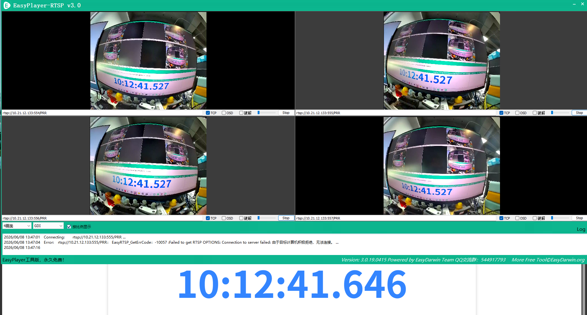

# X5 SC132 四目相机、IMU、UART 与 CAN Demo

英文说明：[README_EN.md](README_EN.md)



这是 RoboBaton 4P 的 V2 non-ROS 公开 Demo 仓库，提供 X5 板端运行包、SC132 四目相机 RTSP 示例、ICM-42670-P IMU 示例、UART1/UART7 示例、SocketCAN CAN 示例、公开头文件和匹配的预编译运行库。

> **最终用户说明以 [4P_doc](https://4p-docs.readthedocs.io/zh-cn/latest/index.html) 为准。** 本 README 只保留仓库入口、最小运行方式和支持边界；部署、保存、接线、数据/API 合同和故障排查请直接阅读文档站。

当前源码使用 `icm42670_*` / `icm42670_driver.h`，SONAME `libicm42670.so.2`、real SO `libicm42670.so.2.0.0`。IMU ABI 2.1 的基础函数保留 `ICM42670_X5_2.0`，新增 FSYNC callback 位于 `ICM42670_X5_2.1`。旧 V1 下载包不能用于该接口；软件版本、文档修订和板端验收分别识别，同一版本字符串不证明 manifest 相同。上图是 V1 产品示意，不是 V2 pinout 或照片证据。

## 包含内容

```text
demo/       可部署到 X5 `/root/demo` 的完整运行包（含 `mosaic_rtsp_demo` 四路拼接示例）
include/    公开 C 头文件
lib/        与当前 Demo/头文件匹配的预编译库
config/     `sensor_demo` 默认 YAML
src/        Demo 示例源码（含 `mosaic_rtsp_demo.cpp` / `mosaic_nv12.*`）
scripts/    构建、打包和运行包验证入口（含 `build_mosaic_rtsp_demo.sh`）
```

用户通常只需要 `demo/`。不要只替换单个 ELF、单个 `.so` 或配置文件。

当前相机 ABI 2.2 在 `sc132_frame_info_t.exposure` 中提供逐帧冻结的 ISP 曝光观测；bag 帧元数据、MP4 `exposure.jsonl` 和 tee 索引同步保存。`status=1` 仅为估计值，不是该帧实际生效曝光或真实曝光中心；`status=0` 为不可用。字段、关联键及限制见[数据合同](https://4p-docs.readthedocs.io/zh-cn/latest/development/data-contracts.html)。

## 版本与运行包匹配

本仓库、`demo/`、预编译库和公开文档按同一发布组合使用。请先确认 `VERSION`、仓库 tag 和运行包 `manifest.sha256`，不要混用不同版本的源码、头文件、动态库和运行包。

板端可查询程序和运行库版本：

```bash
cd /root/demo
./cam_demo --version
./mosaic_rtsp_demo --version
./sensor_demo --version
./imu_reader_demo --version
./serial_port_demo --version
./can_demo --version
```

各 demo 的 `--version` 会输出自身产品版本，并报告该进程实际链接的自研 SO 版本：`cam_demo` 与 `mosaic_rtsp_demo` 报告 `libsc132`/`libprrtsp`，`sensor_demo` 报告 `libicm42670`/`libsc132`/`libprrtsp`，`imu_reader_demo` 报告 `libicm42670`，用于发现程序与 SO 混装。

这些版本查询不需要初始化相机、IMU 或 UART。完整版本、兼容性和 ABI 说明见 [产品版本与兼容性](https://4p-docs.readthedocs.io/zh-cn/latest/getting-started/product-and-compatibility.html)、[API 参考](https://4p-docs.readthedocs.io/zh-cn/latest/development/api-reference.html) 和 [版本更新记录](https://4p-docs.readthedocs.io/zh-cn/latest/changelog.html)。

## Demo 选择

| 程序 | 用途 |
|---|---|
| `sensor_demo` | 四路相机、RTSP 和 IMU 联合运行；可选择 ROS1 bag 或 H.264 MP4 保存 |
| `cam_demo` | 四路相机和 RTSP |
| `mosaic_rtsp_demo` | 四路 NV12 拼接为一路 RTSP，默认端口 `558` |
| `imu_reader_demo` | 独立 IMU 读取 |
| `serial_port_demo` | UART1/UART7 串口示例；不适用于 DEBUG_UART |
| `can_demo` | TCAN4550 的 SocketCAN 经典 CAN 收发示例；接口须预先配置，不支持 CAN FD |

## 默认运行

默认运行包位于 `demo/`；部署完成后在 X5 上执行：

```bash
cd /root/demo
./sensor_demo
```

只运行相机/RTSP：

`cam_demo` 演示如何同时使用：

- `libsc132.so`：启动 SC132 四目相机，并通过 frame-set callback 获取配组后的 NV12 DMA 帧
- `libprrtsp.so`：把四路 NV12 帧送入 X5 编码器并输出 RTSP

六个 demo 可执行文件已经按 X5 运行环境链接。请保持 `sensor_demo`、`cam_demo`、`mosaic_rtsp_demo`、`include/` 和 `lib/` 中的二进制库来自同一份运行包；不要混用系统目录或其他工程里的同名 `.so`，否则可能出现启动失败或运行时符号不匹配。

```bash
./cam_demo
```

### Mosaic RTSP Demo

四路拼接 RTSP 示例：

```bash
./mosaic_rtsp_demo
./mosaic_rtsp_demo --fps 40
./mosaic_rtsp_demo --fps 50
```

固定 RTSP 地址 `rtsp://<x5-ip>:558/PRR`，支持 `--fps <25|30|40|50|60>`。详细参数、运行统计与边界见 [non-ROS Demo 使用](https://4p-docs.readthedocs.io/zh-cn/latest/usage/non-ros-demo.html#non-ros-mosaic)。

只运行 IMU：

```bash
./imu_reader_demo
```

`imu_reader_demo` 在 stop 后输出一条 `IMU_RUNTIME_HEALTH final=yes`，包含会话有效性、producer/consumer 样本数、日志丢弃及最终 GPIO/FIFO/mapper/无效包计数。样本与最终摘要均为非阻塞尽力输出；缺失摘要不能作为健康通过证据。`--print-rate-hz 0` 仅关闭样本，不关闭最终摘要。

运行 UART1/UART7 示例：

```bash
./serial_port_demo
```

### CAN Demo

先由 BSP 正确注册并配置 CAN 网络接口；`can_demo` 不访问 SPI 寄存器、不修改设备树、GPIO、bitrate 或接口状态。支持经典 CAN 标准/扩展数据帧发送，以及数据帧/远程帧接收，载荷为 `0..8` 字节，不支持 CAN FD。

```bash
cd /root/demo
./can_demo --help
# 接收：默认 can0，Ctrl-C 退出；也可指定有限计数与空闲超时
./can_demo --interface can0 --mode rx --count 10 --timeout-ms 5000
# 发送 10 个标准帧，ID 按十六进制，数据不带分隔符
./can_demo --interface can0 --mode tx --id 123 --data 0102030405060708 --count 10 --interval-ms 100
# 29-bit 扩展帧；默认只发送一次
./can_demo --interface can0 --mode tx --extended --id 1ABCDE --data AABB
```

无参数默认持续接收；TX 默认发送一个 `123#0102030405060708`，`--count 0` 持续运行。退出码 `0` 为完成或正常中断，`1` 为接口/I/O/接收超时失败，`2` 为参数错误。`tx_queued` 仅表示内核接受；本机 SocketCAN 回环不证明外部收发。接口配置、接线与双节点验证见 [CAN 使用](https://4p-docs.readthedocs.io/zh-cn/latest/usage/non-ros-demo.html#non-ros-can)。单独构建用 `TOOLCHAIN_FILE="$TOOLCHAIN_FILE" scripts/build_can_demo.sh`，完整生成 `demo/` 用 `scripts/package_runtime.sh`。

首次上电、网络、部署前置条件和 `cam-service` 要求见 [首次上电与开机使用](https://4p-docs.readthedocs.io/zh-cn/latest/getting-started/first-boot.html) 和 [快速开始](https://4p-docs.readthedocs.io/zh-cn/latest/quick-start.html)。

## 开机自启动

`sensor_demo` 的开机自启动由运行包顶层脚本 `start_sensor_demo.sh` 管理：

```bash
cd /root/demo
./start_sensor_demo.sh            # 前台启动 sensor_demo（等效 ./sensor_demo）
./start_sensor_demo.sh enable     # 安装开机自启动（需要 root）
./start_sensor_demo.sh disable    # 取消开机自启动（需要 root）
./start_sensor_demo.sh status     # 查看自启动与运行状态
```

开机自启动通过板端 `/userdata/startup.sh` 实现（系统 `S99auto_startup` 在 `/userdata` 挂载后执行）；脚本只追加/删除自己带标记的块，不影响其它脚本（如 `wifi_setup.sh`）写入的内容。自启动使用包内默认配置，直接修改 `config/sensor_config.yaml` 即可调整，无需重新执行 `enable`。

曝光中点测试可在 `config/sensor_config.yaml` 的 `camera` 段设置 `test_exposure_midpoint: true`，默认 `false`；重启 `sensor_demo` 后生效。显式 YAML 覆盖 `SC132_TEST_EXPOSURE_MIDPOINT`，省略该键时才沿用环境变量。图像时间戳（包括 ROS1 bag 图像 `header.stamp`）使用触发时间加半曝光时长的估算值，不改变 IMU 或 bag record time；曝光不可用则停止采集。需重建应用及支持此开关的 `libsc132.so`，旧预编译包不自动支持；这不是已校准的真实曝光中点。详见[数据合同](https://4p-docs.readthedocs.io/zh-cn/latest/development/data-contracts.html#test-exposure-midpoint)。

## 保存数据

`sensor_demo` 默认不自动保存；默认保存格式字段为 MP4，默认路径为 `/root/demo/save_mp4/`。需要启用保存时显式选择一种模式：

```bash
# ROS1 bag v2.0
./sensor_demo --record-bag /data/run.bag

# H.264 MP4 session
./sensor_demo --record-mp4-dir /data/mp4_session
```

ROS1 bag 与 MP4 互斥；MP4 只支持 H.264 和完整四路，frame skip 只适用于 ROS1 bag。完整输出文件、停止顺序、完整性判定、partial/recovery 和离线转换见 [数据保存](https://4p-docs.readthedocs.io/zh-cn/latest/usage/save-data-guide.html)。

当前 MP4 session 始终创建 `exposure.jsonl` 和 `fsync.jsonl`，后者仅在 FSYNC 启用后有记录。曝光 sidecar 是输入帧观测，可能多于编码保存帧；按相机与微秒量化组触发时间对照 CSV，不按行号或源帧号直接索引 MP4。默认 `--imu-sample-drop-policy allow-counted` 可继续计数丢样；bag complete 不单独保证 producer 零丢样，MP4 complete 还检查最终 producer 健康和样本计数。完整数据集必须回读实际载荷，不能只看退出码或 MP4 能否播放。

## 从源码构建

本仓库在 Ubuntu 22.04 x86_64 开发机交叉编译，X5 板端运行生成的运行包。构建前准备匹配的 `./include`、`./lib`、`x5_4cam_cross_toolchain_20261009` 工具包和主机 CMake；下载发布状态与主机安装步骤见下方源码编译页。

```bash
export X5_TOOLCHAIN_ROOT="/path/to/x5_4cam_cross_toolchain_20261009"
source "$X5_TOOLCHAIN_ROOT/setup_4cam_cross_env.sh"
cmake -S . -B build_x5 \
  -DCMAKE_TOOLCHAIN_FILE="$TOOLCHAIN_FILE"
cmake --build build_x5 --parallel 4
```

维护者刷新完整运行包时使用：

```bash
scripts/package_runtime.sh --toolchain-file "$TOOLCHAIN_FILE"
python3 scripts/verify_runtime_package.py demo
```

打包支持独立克隆仓库，校验源提交、文件哈希及完整运行包。自定义 `--build-dir` 必须位于源码仓库内；切换工具包后使用新的构建目录。

完整工具链、依赖、构建边界和运行包验证见 [公开 Demo 源码编译](https://4p-docs.readthedocs.io/zh-cn/latest/development/open-source-build.html)。

## 部署

板端目标目录为 `/root/demo`。部署必须遵循：

```text
唯一临时目录
→ 完整 manifest 校验
→ 检查旧应用退出
→ 备份旧目录
→ 原子切换
→ help/smoke 验证
→ 失败恢复最近备份
```

不要使用“先删除 `/root/demo`，再上传新包”的方式，也不要在 `cam-service` 停止时进行相机测试。完整命令见 [部署、升级与回滚](https://4p-docs.readthedocs.io/zh-cn/latest/development/deployment-and-upgrade.html)。

## 支持边界摘要

- 相机输出为 NV12，默认 `1280x1088`，可选 VSE 硬件整幅缩放画布 `640x480`、`720x480`、`1280x720`；RTSP 默认 H.264、H.265 可选，path 为 `/PRR`，四路默认端口为 `554..557`。
- 相机公开支持 `25/30/40/50/60fps`，默认 `30fps`；`rotate=180` 只支持 `30fps`。
- IMU 原生支持 `25/50/100/200/400/800/1600Hz`，默认 `800Hz`，使用 sensor-timestamp FIFO；旧 `500/1000/2000Hz` 明确拒绝，不会自动重采样。
- 所有相机采集入口仅支持 VIN LPWM 硬件触发；相机与 IMU FSYNC 共用 LPWM IO，INT1 为 `34120000.gpio` offset `8`。相机硬件触发沿、IMU 样本及 INT1 时间统一映射至 `CLOCK_REALTIME`，CLI/保存原样保留；bag record time 独立读取 realtime。运行中桥接持续更新，允许系统校时回拨，内部超时仍用单调时钟。相机需要 X5 `/dev/mem` 只读访问；捕获/有界映射缺失即停止，不用到帧时间兜底。同域不提供 FSYNC 样本/曝光关联、TF 或标定。
- `sensor_demo --fsync --sample-rate-hz 1600` 或 YAML `imu.fsync_enabled: true` 显式开启触发—样本关联（默认关闭，仅 `800/1600Hz`）；结果输出 stdout、bag `/robobaton/fsync` 或 MP4 `fsync.jsonl`。只接受 `status=1`，缺失/歧义显式报告；不改变采样相位，不承诺曝光同步或零丢失。
- IMU consumer 使用 `SCHED_RR/3`，采集 owner 使用 `SCHED_FIFO/20`，相机 RAW observer 使用 `SCHED_FIFO/60`，独立 INT1 时钟 observer 使用 `SCHED_FIFO/30`；两个 observer 均继承允许 CPU 集合、每轮休眠 `50µs`，需实时调度权限。INT1 observer 低于板端默认 GPIO IRQ 的 FIFO/50，并在 SPI 等待和 callback 延迟期间保留沿时证书。跨优先级队列使用优先级继承锁，但应用不自动修改系统 IRQ/debug 配置。压测须检查 stop 后最终 `IMU_RUNTIME_HEALTH` 并回读实际保存载荷；计数丢弃不等于零丢失。
- UART1/UART7 保持 `3.3V`，DEBUG_UART 保持 `1.8V`；V2 UART7 5pin 有独立 IO 默认作 PPS 输入，无需复用 RX/TX。完整 pinout、供电脚限值与热插拔边界以正式 V2 硬件资料为准，不沿用 V1 `500mA` 或历史验收。
- 相机运行依赖 X5 板端 `cam-service`；本仓库不是通用主机运行包。

完整相机、IMU、UART、时间戳、帧率和数据语义见 [数据合同](https://4p-docs.readthedocs.io/zh-cn/latest/development/data-contracts.html)、[non-ROS Demo 使用](https://4p-docs.readthedocs.io/zh-cn/latest/usage/non-ros-demo.html) 和 [硬件连接与安全](https://4p-docs.readthedocs.io/zh-cn/latest/getting-started/hardware-and-safety.html)。

## 故障排查

遇到启动、动态库、RTSP、IMU 或 UART 问题时，请保留 `VERSION`、manifest 校验结果、执行命令、退出码和必要日志，不要提交真实 IP、凭据或内部路径。排查入口：[故障排查](https://4p-docs.readthedocs.io/zh-cn/latest/troubleshooting.html)。

## 公开文档索引

- [产品介绍](https://4p-docs.readthedocs.io/zh-cn/latest/getting-started/Product_Introduction.html)
- [产品版本与兼容性](https://4p-docs.readthedocs.io/zh-cn/latest/getting-started/product-and-compatibility.html)
- [首次上电与开机使用](https://4p-docs.readthedocs.io/zh-cn/latest/getting-started/first-boot.html)
- [快速开始](https://4p-docs.readthedocs.io/zh-cn/latest/quick-start.html)
- [non-ROS Demo 使用](https://4p-docs.readthedocs.io/zh-cn/latest/usage/non-ros-demo.html)
- [部署、升级与回滚](https://4p-docs.readthedocs.io/zh-cn/latest/development/deployment-and-upgrade.html)
- [公开 Demo 源码编译](https://4p-docs.readthedocs.io/zh-cn/latest/development/open-source-build.html)
- [数据保存](https://4p-docs.readthedocs.io/zh-cn/latest/usage/save-data-guide.html)
- [数据合同](https://4p-docs.readthedocs.io/zh-cn/latest/development/data-contracts.html)
- [API 参考](https://4p-docs.readthedocs.io/zh-cn/latest/development/api-reference.html)
- [硬件连接与安全](https://4p-docs.readthedocs.io/zh-cn/latest/getting-started/hardware-and-safety.html)
- [故障排查](https://4p-docs.readthedocs.io/zh-cn/latest/troubleshooting.html)
- [版本更新记录](https://4p-docs.readthedocs.io/zh-cn/latest/changelog.html)

许可证和第三方组件说明以本仓库的 `LICENSE` 及发布说明为准。
